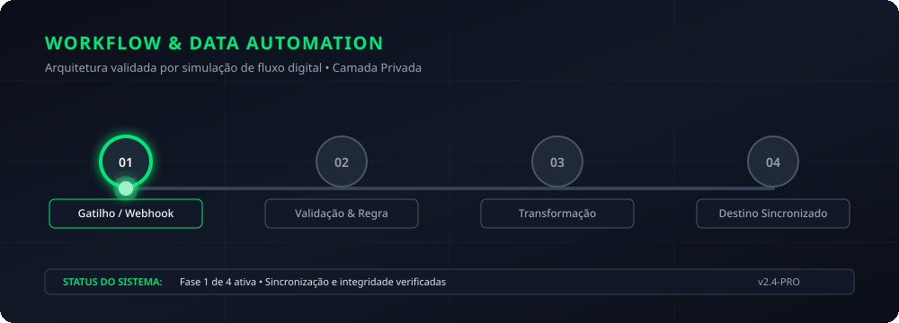
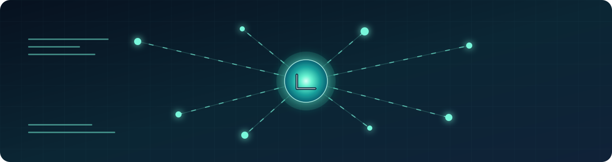

# Kawã Silva dos Santos

  
  

> **Estudante de Tecnólogo em Segurança da Informação** com foco em Python, desenvolvimento web e aplicações seguras.
> 

Construo projetos versionados para transformar estudo e prática em entregas demonstráveis. Meu interesse está na interseção entre desenvolvimento, automação para Linux e fundamentos de segurança da informação.

## Em foco

- **Formação:** Tecnólogo em Segurança da Informação — UniFatecie.
- 
- **Segurança:** Redes TCP/IP e IPv6, Linux e Windows, Bash, OSINT, vulnerabilidades e proteção contra phishing.
- 
- **Desenvolvimento:** Python, TypeScript, JavaScript, HTML, CSS, React, Node.js, SQL e PostgreSQL.
- 
- **Boas práticas:** Git, documentação, testes, autenticação JWT e controle de acesso com RLS.
- 

## Projetos em destaque

### [Portfólio técnico](https://leviatad21.github.io/)

Projetos, trajetória de estudo e evolução profissional em tecnologia.

### [FairMove](https://github.com/LEVIATAD21/FairMove)

Plataforma de mobilidade com arquitetura modular, TypeScript, Node.js e PostgreSQL.

### [eShark](https://github.com/LEVIATAD21/eshark)

Central de comparação de ofertas por preço, frete, prazo e reputação.

### [Padaria Xodó](https://github.com/LEVIATAD21/Padaria-xod-)

Vitrine demonstrativa de pedidos desenvolvida com Next.js e TypeScript.

### [AI Agents Team](https://github.com/LEVIATAD21/ai-agents-team)

Experimento em Python para coordenação de agentes de terminal e tarefas colaborativas.

### [Cardápio](https://github.com/LEVIATAD21/cardapio)

Interface de cardápio digital com filtros e sacola mantida durante a sessão.

## Forma de trabalho

Priorizo requisitos claros, soluções simples de verificar, código legível, documentação objetiva e evolução incremental. Nos projetos próprios, aplico atenção a autenticação, dados sensíveis, validação de entradas e experiência de uso.

## Contato profissional

Estou aberto a oportunidades de estágio, posições júnior e projetos compatíveis com meu momento de formação em tecnologia e Segurança da Informação.

- Portfólio: [leviatad21.github.io](https://leviatad21.github.io/)
- 
- LinkedIn: [kawa-silva-dev](https://www.linkedin.com/in/kawa-silva-dev/)
- 

