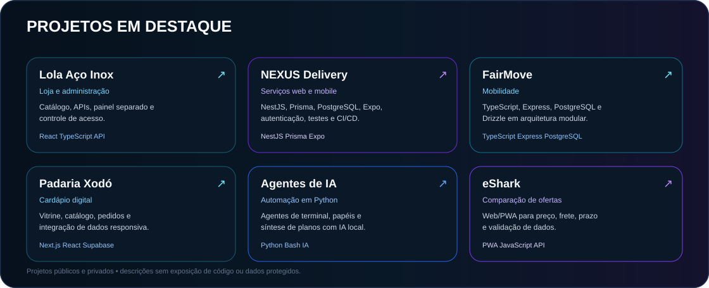
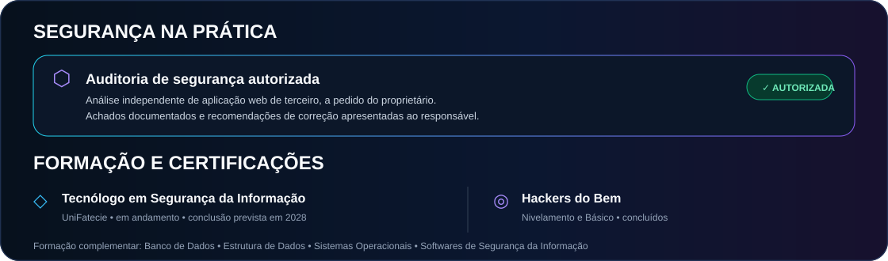

  

<h1 align="center">Kawã Silva dos Santos</h1>

  <strong>Full Stack • Backend • Mobile • Segurança da Informação</strong> 
  Construindo software, integrações e aplicações com foco em qualidade, segurança e evolução contínua.

  
  
  

---

## 👤 Sobre mim

Sou **Kawã Silva dos Santos**, desenvolvedor com prática em projetos **web, mobile, APIs e automação**. Curso **Segurança da Informação na UniFatecie**, com conclusão prevista para 2028, conectando essa formação ao desenvolvimento de software.

Trabalho com **JavaScript, TypeScript, Python, Node.js, React, React Native, bancos de dados e Linux**. Meus projetos passam por comércio eletrônico, mobilidade, delivery, ferramentas de IA e sistemas de pedidos, com atenção a **controle de acesso, validação de dados, testes, documentação e revisão técnica**.

> 🎯 **Busco oportunidades 100% remotas de estágio, trainee ou júnior em Segurança da Informação, Backend, Frontend ou Full Stack**, no Brasil ou em equipes internacionais.

---

## 🧩 Stack principal

  

<strong>Ver tecnologias e ferramentas em detalhes</strong>

 

| Área | Prática e ferramentas |
| --- | --- |
| **Backend & APIs** | Node.js, Express, NestJS, Python/FastAPI, REST, autenticação e validação |
| **Frontend** | React, Next.js, TypeScript, JavaScript, HTML, CSS, Vite e Tailwind CSS |
| **Mobile** | React Native e Expo |
| **Dados** | SQL, PostgreSQL, SQLite, Prisma, Drizzle e Supabase |
| **Infra / DevOps** | Linux, Bash, Git, Docker e GitHub Actions |
| **Testes** | Jest, Vitest, integração e verificação de tipos |
| **Segurança** | Auditoria autorizada, controle de acesso, validação de entradas e documentação de correções |
| **IA & automação** | Python, agentes de terminal, integração com modelos e IA local |

---

## 📊 Tecnologia em prática

  

**Como interpretar:** o painel mede presença de arquivos no portfólio, **não porcentagem de domínio, anos de experiência ou autoria exclusiva**. Um mesmo projeto pode usar várias tecnologias.

Snapshot de **14/11/2026**: 18 repositórios acessíveis analisados, dos quais 17 com código; o repositório deste perfil fica fora da contagem. **6 projetos têm workflows de GitHub Actions e 4 têm Dockerfile.**

[📄 Dados do painel](assets/skills-evidence.json) · [📐 Método e limites](METRICS.md)

---

## 💼 Projetos em destaque

  

### Links públicos

- **Lola Aço Inox:** [Loja](https://github.com/LEVIATAD21/lola_site) · [Admin](https://github.com/LEVIATAD21/lola_site_admin)
- **NEXUS Delivery:** [Repositório](https://github.com/LEVIATAD21/NEXUS-Delivery)
- **Padaria Xodó / Cardápio Digital:** [Projeto](https://github.com/LEVIATAD21/cardapio)
- **eShark:** [Repositório](https://github.com/LEVIATAD21/eshark)

> Alguns trabalhos permanecem em repositórios privados. As descrições apresentam a experiência técnica sem expor código, dados ou detalhes internos protegidos.

---

## 🛡️ Segurança, formação e certificações

  

Realizei uma **auditoria de segurança web independente, voluntária e autorizada**, a pedido do proprietário de uma plataforma de terceiro. Os achados foram documentados e as recomendações de correção foram apresentadas ao responsável. **Dados confidenciais e detalhes exploráveis de falhas não são publicados neste perfil.**

Minha formação atual inclui **Tecnólogo em Segurança da Informação — UniFatecie**, **Hackers do Bem — Nivelamento e Básico**, além de estudos complementares em **Banco de Dados, Estrutura de Dados, Sistemas Operacionais e Softwares de Segurança da Informação**.

---

## 🤝 Vamos conversar

  <strong>Aberto a oportunidades remotas de desenvolvimento e segurança, colaboração técnica e projetos de software.</strong>

  
  
  

  Software com propósito. Segurança com evidências. Aprendizado contínuo.

